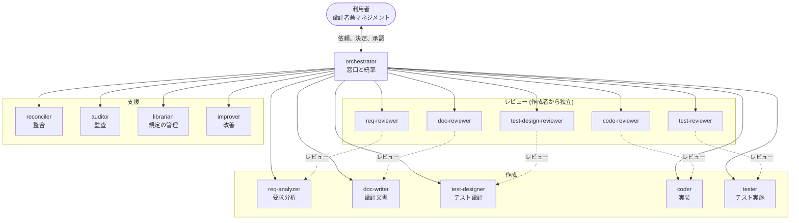
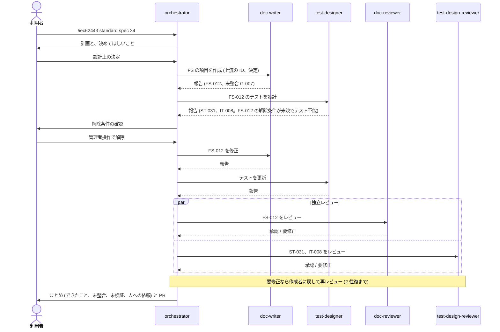
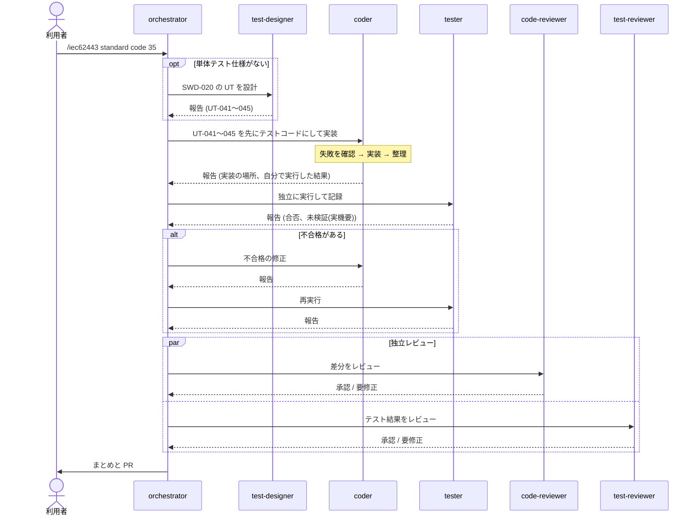
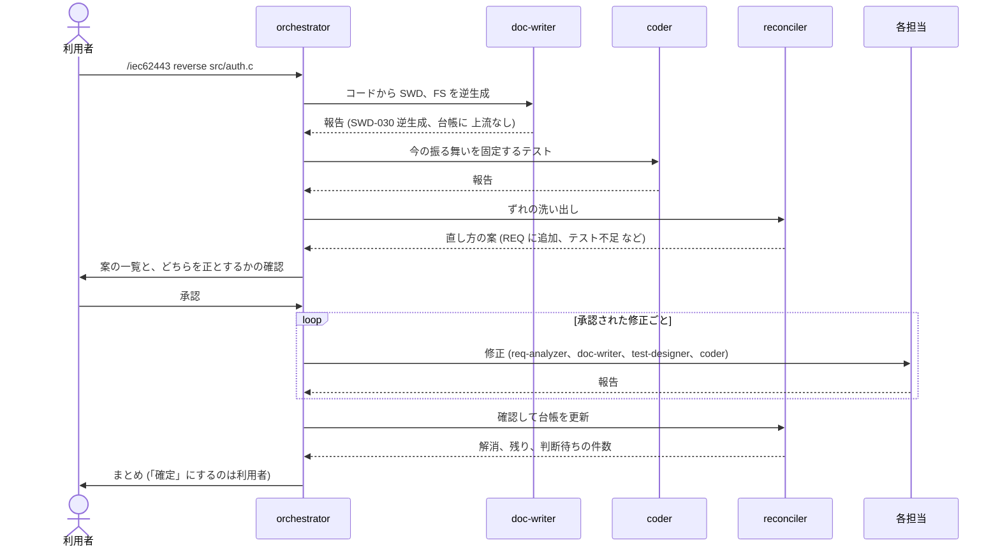
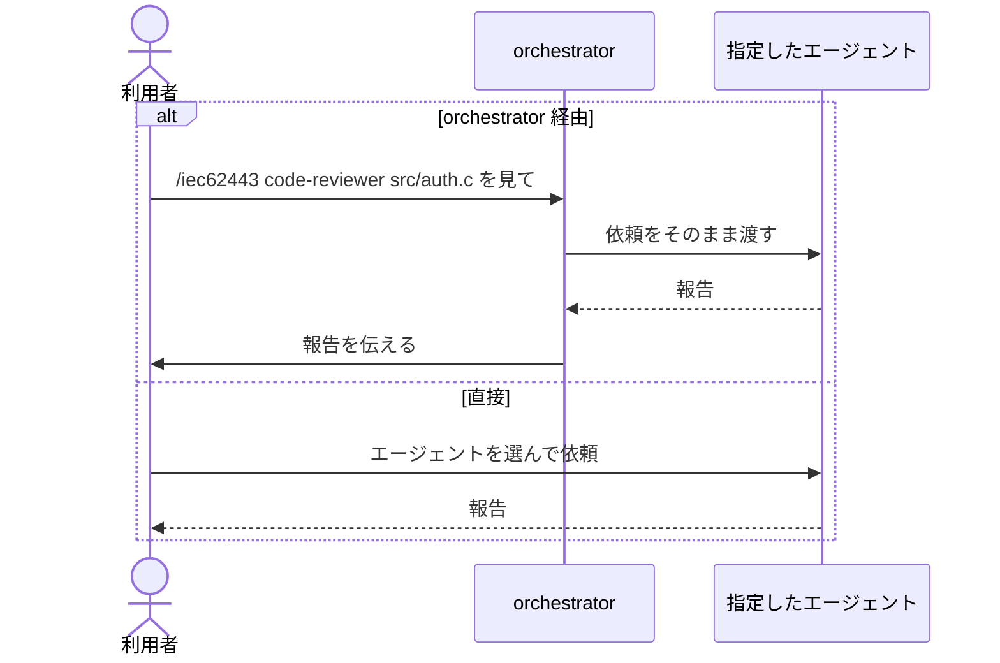

# エージェントの組織と作業の流れ

役割ごとにエージェントを分け、それぞれが自分の役割に要るスキルだけを読む。オーケストレーターは成果物の中身を読まず、ID と報告だけを扱う。これでどのエージェントの文脈も小さく保つ。

## 組織図

- エージェントどうしは直接やり取りしない。依頼と報告はすべて orchestrator を通る。
- 成果物 (文書、テスト、コード) はファイルで受け渡す。orchestrator が渡すのは ID とファイルの場所だけ。

## エージェントとスキルの割当て

| エージェント | sec-base | 役割のスキル | 編集できるもの |
|---|---|---|---|
| orchestrator | — | iec62443 | PR、初期設定 |
| req-analyzer | ○ | sec-requirements | REQ、トレース表、台帳 |
| doc-writer | ○ | sec-docs | ARC、FS、SWD、トレース表、台帳 |
| test-designer | ○ | sec-test-design | UT、IT、ST の仕様、トレース表、台帳 |
| coder | ○ | sec-coding | コード、テストコード、トレース表、台帳 |
| tester | ○ | sec-test-exec | テスト結果、手順書、トレース表、台帳 |
| req-reviewer | ○ | sec-review、sec-requirements | なし |
| doc-reviewer | ○ | sec-review、sec-docs | なし |
| test-design-reviewer | ○ | sec-review、sec-test-design | なし |
| code-reviewer | ○ | sec-review、sec-coding | なし |
| test-reviewer | ○ | sec-review、sec-test-exec | なし |
| reconciler | ○ | sec-reconcile | トレース表、台帳 |
| auditor | ○ | sec-audit、sec-reconcile | 監査結果 |
| librarian | ○ | sec-org-rules | 規定の索引 |
| improver | ○ | sec-improve | 固有ルール、学びの記録 |

`sec-org-rules` は、`project.yml` の `org_rules_dir` が設定されているときに全エージェントが読む。

### 割当てを変える

| 範囲 | 方法 |
|---|---|
| 1 つのプロジェクトだけ、スキルを足す | `.sec62443/project.yml` の `agent_skills` に書く。例: `agent_skills: {coder: [.github/skills/our-rtos/SKILL.md]}` |
| 全体で変える | `.github/agents/<名前>.agent.md` の「スキル」の行を直し、`python tools/sync_agents.py` で Claude Code 用を作り直す |
| エージェントを足す | `.github/agents/` に定義を足して同じく生成し、`.github/skills/iec62443/SKILL.md` の割り振りの表に加える |
| スキルを足す | `.github/skills/<名前>/SKILL.md` を作り、使わせたいエージェントに割り当てる |

## 作業の流れ

### 文書の工程 (例: `standard spec`)

テストを先に設計し、テストが書けない項目は作成者に戻す。

### 実装の工程 (例: `standard code`)

### 順序どおりに進まないとき (コード先行と整合)

### 1 つのエージェントだけに任せる

